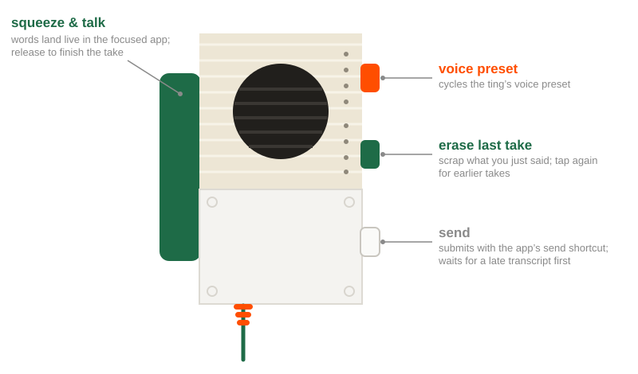

# tinker

**Smart push-to-talk for the [Teenage Engineering EP-2350 "ting"](https://teenage.engineering/store/ep-2350): squeeze the handle and talk to whatever app is in front, using that app's own dictation.**

> tinker is a fork of [tutorintelligence/tingle](https://github.com/tutorintelligence/tingle)
> (MIT, © Tutor Intelligence). tingle does all the hardware work — the
> on-device event engine, the ultrasonic chirp protocol, USB serial, firmware
> flashing, built-in dictation. tinker adds per-app routing (Claude ⌘D,
> Codex, MacWhisper, Handy, then built-in) and a live menu bar waveform
> that shows where your speech is going. Everything below that mentions
> "tingle" behaviour still applies.

<p align="center"></p>

Squeeze the ting's trigger and talk — your words appear live in whatever app
is focused (Claude Code, Codex, anything). Release to finish, tap orange to
send, tap green to scrap the take, tap white to summon your agent to the
front. It's a physical push-to-talk button for coding with agents: pick up
the mic, say what you want, put it down.

Under the hood, a tiny MicroPython event engine installs onto the ting's own
disk in one click (no firmware modification, fully reversible). Button
presses reach your Mac instantly over USB, or — with no USB attached, the
ting on batteries — over an inaudible ultrasonic chirp protocol on the
3.5mm audio cable. You never think about any of that; you just squeeze
and talk.

## Requirements

macOS only. Live **dictation requires macOS 26 (Tahoe) or later** — it uses
Apple's on-device `SpeechAnalyzer`. Everything else (button macros,
keystrokes, shell actions) works on macOS 13+. Apple Silicon or Intel. You
also need the hardware below.

## Hardware setup

You need:

1. **A Teenage Engineering EP-2350 "ting"** — the lo-fi FX microphone.
2. **A USB line-in adapter.** The ting's curly cable outputs *line-level*
   audio, and Mac headphone jacks don't accept line-in — plugging the ting
   straight into your laptop's 3.5mm port will not work. Any USB audio
   interface with a line input is fine; two that are tested and work well:
   the [Sonos Line-In adapter](https://www.bhphotovideo.com/c/product/1754583-REG/sonos_ldnglww1blk_sonos_line_in_adapter.html)
   (smallest option — a bare USB-C dongle) and the
   [Cubilux USB-C line-in adapter](https://www.amazon.com/dp/B0CNCL21RR)
   (bulkier; adds mic-in + headphone-out).
3. Optionally, **a USB-C cable** to the ting for docked use (instant button
   events, battery readout) and for the one-time flash.

Wiring: ting line-out → adapter **line-in** port → Mac USB. Turn the green
volume knob under the ting's lid up to around halfway.

**Setting up a new ting:** dock it over USB and click **Flash EP** in the
tingle menu — for a ting tingle hasn't seen before, this runs the guided
firmware upgrade first (shipped firmware corrupts the button signals over
the audio cable) and installs everything in one flow.

## Getting started

### Install from a release

Grab the latest `tinker-<version>.zip` from the
[Releases page](https://github.com/noahread/tinker/releases), unzip it and
move `tinker.app` to `/Applications`. Releases are built by GitHub Actions
from a `v*` tag. Until a Developer ID certificate is configured in the
repository's secrets they are ad-hoc signed, so macOS will refuse the first
launch; clear the quarantine flag once:

```bash
xattr -dr com.apple.quarantine /Applications/tinker.app
```

(or right-click the app → Open). A locked-down work Mac may not allow that
at all; build from source there instead.

### Install from source

You need Xcode Command Line Tools (`xcode-select --install`) and macOS 26+
for built-in dictation.

```bash
git clone https://github.com/noahread/tinker.git && cd tinker && scripts/install.sh
```

That builds, installs to `/Applications` and launches tinker. Signing is
auto-detected: a Developer ID or Apple Development certificate in your
keychain gives the app a stable identity so the Microphone and
Accessibility grants survive rebuilds; with no certificate it is ad-hoc
signed and macOS re-asks after each rebuild.

### Using one ting on several Macs

Everything the ting needs lives on the ting: the firmware, the event
engine, the chirp tones, plus a small `tinker.json` marker that records
them. Install tinker on each Mac, grant it Microphone and Accessibility,
and plug the mic in. On batteries over the audio cable it is recognised by
its heartbeat straight away; dock it over USB-C once and tinker reads the
marker, so the menu shows "Flash EP… (already set up)" and the firmware
item reads "(latest)" instead of walking you through setup again. Only
tinker's own config (`config.toml`) is per Mac.

### First run

1. Launch tinker — a striped-circle icon appears in the menu bar.
2. Plug the ting in over USB-C and choose **Flash EP…** from the menu (skip
   this on a second Mac — a ting set up elsewhere is recognised). This
   writes four inaudible signal tones and the event engine onto the ting's
   disk (existing contents are backed up first). Power-cycle the ting when
   prompted: press the small button above its USB-C port, then push the
   handle to start it.
3. Grant the two permission prompts (microphone, accessibility) — tinker
   asks at launch, and the menu bar icon wears an orange "!" badge with
   fix-it menu items until both are granted.
4. Open the menu: the first lines tell you what a squeeze would do in
   the app you came from ("Squeeze in Claude: Claude → ⌘D (toggle)") and
   which fallback applies. **Simulate squeeze (2 s)** fires the whole
   route without the ting, so you can check a profile before you flash.
5. Squeeze the trigger and talk. The menu bar item turns into a live
   waveform with "→ Claude" (or whichever app the speech is going to).

The menu bar dot tells you everything: green = ting present (USB, or heard
by its ultrasonic heartbeat), orange = searching, red = trigger held /
dictating, none = no ting around. Input-device selection is automatic —
tinker finds whichever line-in the ting is plugged into by listening for
its heartbeat.

## Where your voice goes

Every squeeze is routed, in this order:

1. **The frontmost app's own dictation.** If the app in front has a
   profile, tinker drives its shortcut. Shipped profiles: **Claude** (⌘D,
   toggle: pressed on squeeze and again on release) and **Codex** (hold:
   bind Codex's *press to dictate* key to F18 in its settings).
2. **A fallback transcription app that is running.** Shipped, in order:
   **MacWhisper** (Settings › Dictation: toggle mode, shortcut ⌃Z) and
   **Handy** (via `handy --toggle-transcription`). Install whichever you
   use on each Mac; the first one that is running wins.
3. **Built-in dictation** (tingle's on-device Apple SpeechAnalyzer, macOS
   26+): types live into the focused field. Always available.

The route is pinned when you squeeze: if you ⌘-Tab away mid-sentence,
the closing ⌘D still goes back to Claude.

Open **Settings…** from the tinker menu to manage all of this: the Apps
tab lists the apps with their own dictation (Claude and Codex on, ChatGPT
and Cursor as disabled starting points until you set their shortcuts),
each with its mode, shortcut and send key; the Fallback tab orders the
transcription apps (MacWhisper, Handy, Superwhisper) and shows which is
running; General holds the input switch, waveform and default send key.
"Add app…" picks any installed app. Changes apply immediately and are
saved to `settings.json`, which the window owns; `config.toml` keeps
vocabulary, replacements and the ting's button mappings, and can still
add apps by hand:

```toml
[apps."com.apple.Notes"]                         # osascript -e 'id of app "Notes"'
name = "Notes"
dictation = { mode = "toggle", key = "f17" }    # the shortcut you set in that app

[apps."com.superduper.superwhisper"]
name = "Superwhisper"
dictation = { mode = "hold", key = "f18", modifiers = ["cmd"] }
```

`mode = "toggle"` presses the chord on squeeze and release; `mode = "hold"`
holds it down for the whole squeeze (push-to-talk hotkeys). For anything
else give explicit `triggerDown` / `triggerUp` actions (`keystroke`,
`keyHold`, `shell`). `[apps]` tables merge with the defaults per app; a
`[[fallback]]` list in `config.toml` replaces the shipped list. Once you
have used the Settings window, its lists win over both. See
`default-config.toml` for every option, including
`[routing] switchDefaultInput = true`, which makes the ting's adapter the
system input while you hold the handle so the external app records the
ting's mic instead of your laptop's.

## Default controls

<p align="center"></p>

| Input | Action |
|---|---|
| squeeze handle | voice into the focused app, via its own dictation, a fallback transcriber, or built-in dictation; release to finish |
| white button | send it: the app's submit shortcut (Return, or ⌘Return where configured), waiting for a late transcript first |
| green button | erase the last dictated take (repeat for earlier takes); also cycles the ting's mode LED, which changes nothing here |
| orange button | unmapped (cycles the ting's own voice preset); the default config shows how to make it summon your agent |

Every one of these is just a default. tingle is configurable by design —
the summon list, what each button does, the dictation vocabulary, the
rewrite pass — but the defaults are meant to be good enough that most
people never open the config.

## Configuration

Two files in `~/Library/Application Support/tingle/`:
`default-config.toml` holds every option, documented, and is refreshed by
the app on every launch — it's the reference, so new options and new
built-in vocabulary arrive with updates. Your own `config.toml` ("Edit
config…" in the menu) contains only what you change: copy any key over,
edit it, save — it wins over the default and reloads live.

```toml
extraVocabulary = ["Metabase", "kubectl"]     # your jargon, added onto the built-in list

[replacements]                                # fix what biasing can't
"Tamil" = "TOML"

[mappings]                                    # merges per key with the defaults
mode1 = { type = "shell", command = """
open -a "Claude"                              # multiline scripts welcome
""" }
```

Actions: `dictate`, `eraseDictation`, `keystroke`, `keyHold` (held until you
release the trigger), and `shell`. The white button gives you four mappable
slots (`mode1`–`mode4`), selected by the ting's green mode LED.

Dictation uses Apple's on-device speech stack (macOS 26+). Everything else
works on macOS 13+.

With Apple Intelligence available, an on-device LLM polishes each take a
moment after you release (on by default; `[rewrite]` in the config): fillers
gone, punctuation fixed, your jargon corrected — all locally, nothing
leaves the Mac, and it never touches your words' meaning (degenerate model
output is rejected and your original text stays).

**About the orange microphone icon:** macOS shows its privacy indicator
whenever any app captures audio input — tingle is always listening to the
line-in for the ting's chirps, so the icon is expected and can't be
hidden. The "mic mode" options macOS offers there (Voice Isolation etc.)
only affect video-conferencing-style apps; tingle's raw capture ignores
them.

## How it works

The ting executes user Python from its USB disk at boot. tingle (and so tinker) ships an
event engine that chains the stock firmware behavior, then reports button
and trigger events as serial lines (over USB) and as ultrasonic codewords
(over the 3.5mm audio cable): every event is four 25ms chirp symbols carrying an
error-correcting code, matched-filter decoded on the Mac — a corrupted
symbol self-corrects, and noise can never turn one button into another.
A state-carrying heartbeat every 2 seconds acts as a pilot signal: it
powers zero-config device discovery, self-healing state sync, and a
decoder lock that keeps a sleeping or absent ting perfectly silent.
Details and the measured hardware reference: [DESIGN.md](DESIGN.md).

## Development

```sh
swift run tingle                # run the menu bar app (dev build)
swift run tingle-tests          # unit tests
python3 tools/test_payload.py   # device event-engine tests
scripts/bundle.sh               # assemble dist/tinker.app
```

Module and target names are still tingle's so `git merge upstream/main`
(`upstream` = tutorintelligence/tingle) stays painless.

Agent-oriented contributor docs: [CLAUDE.md](CLAUDE.md) (symlinked as
AGENTS.md).

## License

MIT © Tutor Intelligence (tingle) and © Noah Read (tinker additions)
